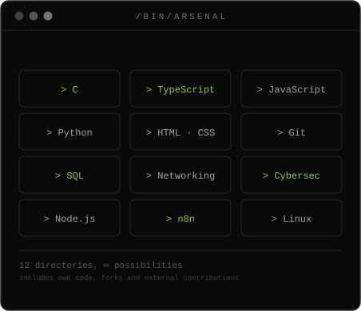
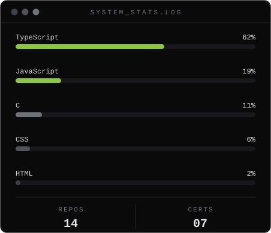

<!-- ═══════════════════════════════════════════════════════ -->
<!--  F E R B _ O S  —  github.com/davicalvarenga  -->
<!-- ═══════════════════════════════════════════════════════ -->

<h3>Featured projects</h3>

<a href="https://github.com/davicalvarenga/Graphs-Code"><b>Graphs-Code</b></a>: step-by-step C graph visualizer (Next.js, TypeScript, 80% test coverage in CI) · <a href="https://graphs-code.vercel.app">live</a> 
<a href="https://github.com/davicalvarenga/Automacao-glpi-nextcloud-n8n"><b>GLPI ticket digest</b></a>: n8n + GLPI REST API daily summaries via Nextcloud Talk and <a href="https://github.com/davicalvarenga/GLPI-Rocket.Chat-via-n8n">Rocket.Chat</a> 
<a href="https://github.com/davicalvarenga/ai-job-search"><b>ai-job-search</b></a>: job application framework adapted for Brazil (Claude Code, LaTeX)

<!-- ── real GitHub activity ── -->

  

  

<i>"If you only read the books that everyone else is reading, you can only think what everyone else is thinking."</i> 📚

 

